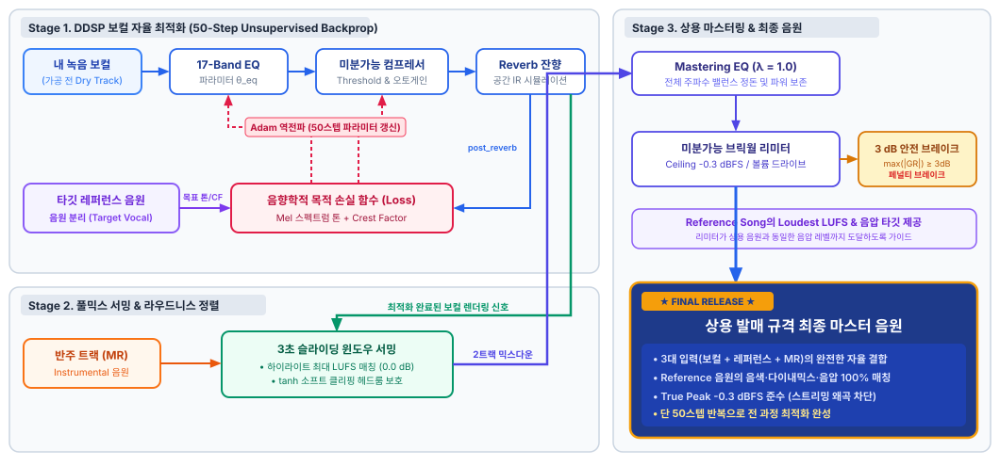

# 미분 가능한 오디오 연산 그래프 기반의<br>레퍼런스 가이드 엔드투엔드 보컬 믹싱 & 마스터링 시스템

### Reference-Guided End-to-End Vocal Mixing & Mastering via Differentiable Audio Graphs

**발표자: 이현중**
2026.09

---

## 전체 목차 (Overview)

1. **믹스의 정의 및 전체 시스템 아키텍처**

2. **핵심 도구 3종의 수학적 모델링 & 플러그인 설계**

3. **최적화 메커니즘 (Optimization Mechanism)**

4. **풀믹스 합산 (Summing with Instrumental)**

5. **마스터링 체인 (Mastering Chain)**

6. **결론 (Conclusion)**


---

## 목차 (Table of Contents)

<div class="toc-container">
  <div class="toc-item active"><span class="num">1</span><span class="title">믹스의 정의 &amp; 시스템 개요</span></div>
  <div class="toc-item"><span class="num">2</span><span class="title">핵심 도구 3종의 수학적 모델링 & 플러그인 설계</span></div>
  <div class="toc-item"><span class="num">3</span><span class="title">최적화 메커니즘 (Optimization Mechanism)</span></div>
  <div class="toc-item"><span class="num">4</span><span class="title">풀믹스 합산 (Summing with Instrumental)</span></div>
  <div class="toc-item"><span class="num">5</span><span class="title">마스터링 체인 (Mastering Chain)</span></div>
  <div class="toc-item"><span class="num">6</span><span class="title">결론 (Conclusion)</span></div>
</div>

---

## 1. 믹스(Mixing)란 무엇인가?

* **정의**: 녹음된 개별 트랙들(보컬, 드럼, 베이스, 신스 등)을 음향학적·음악적으로 조율하여 단 하나의 트랙으로 결합하는 엔지니어링 과정.
* **믹싱의 3대 차원 (3D Audio Space)**:
  1. **주파수 차원 (Frequency / Height)**: 각 악기가 담당하는 주파수 영역을 분할하여 마스킹(소리 묻힘) 방지(ex. 저역이 풍부한 반주와 보컬).
  2. **다이내믹스 차원 (Dynamics / Depth)**: 소리의 크고 작음의 폭을 제어하여 전후 거리감과 에너지 균일성 확보(ex. 하이라이트에서만 큰 보컬을 반주 속에 어떻게 넣느냐).
  3. **시간·공간 차원 (Time & Space / Width & Reverb)**: 잔향을 통해 가상의 입체 음향 공간 구축.

> **보컬 믹싱의 궁극적 목표**: 보컬이 반주(MR)에 묻히지 않고 명료하게 들리면서도, 하나의 공간 안에서 일체감 있게 어우러지도록 만드는 것.

---

## 2. 실제 믹싱 현장에서는 어떤 작업을 하는가?

실제 스튜디오에서 엔지니어가 보컬 트랙을 처리하는 4단계 핵심 워크플로우:

1. **톤 쉐이핑 (Tone Shaping - EQ사용)**:
   - 보컬을 분석하여 특정 주파수대역을 깎거나(Cut) 부스트(Boost)하여 목표 주파수 밸런스 형성.
2. **다이내믹스 제어 (Dynamic Control - Compressor 사용)**:
   - 작은 소리부터 큰 샤우팅까지의 음량 편차를 줄여, 반주 위에서 일정한 에너지를 유지하도록 압축.
3. **공간감 형성 (Spatialization - Reverb 사용)**:
   - 무향실(흡음 부스)에서 건조하게 녹음된 보컬에  잔향(Tail)을 부여.
4. **레벨 밸런싱 & 서밍 (Level Balancing & Summing)**:
   - 보컬과 반주의 음량을 정밀하게 정렬하여 합산(Mixdown).

---

## 3. 기존 연구의 한계 vs 본 연구의 결정적 차이점

### ⚠️ 기존 믹싱 연구의 한계:
* **드라이(Dry) 신호의 부재**: 상용 발매곡의 가공 전 원본 보컬은 일반적으로 확보하기 어려움.
* **환경과 재료의 불일치**: 설령 프로 엔지니어의 설정값을 알아낸다 해도, **"그 수치가 내 보컬에도 잘 어울릴까?"**라는 근본적 한계 존재.
* 🍳 **요리에 비유하자면**:
  - 아무리 셰프의 레시피가 정교해도, **실제 요리하는 사람의 주방과 재료는 셰프의 것과 다름**.
  - 같은 레시피가 같은 맛을 보장하지 않듯, 동일한 믹싱 설정도 다른 녹음에서는 다른 결과를 만듦.

### 💡 본 연구의 접근: Reference-Guided Unsupervised Optimization
* **맛을 비교하며 반복 조정**: 셰프의 레시피를 추정·복제하는 대신, **완성된 맛(레퍼런스의 음색·다이내믹스)**을 목표로 현재 출력과의 차이를 측정하고 파라미터를 반복 갱신.
* **내 재료 맞춤형 역전파**: 대규모 정답 데이터셋 없이, 미분 가능한 DSP(DDSP)를 통해 **내 보컬의 음향 통계에 맞춰 믹싱 파라미터를 직접 최적화**.

---

## 4. 전체 시스템 아키텍처 및 데이터 흐름도



---

## 목차 (Table of Contents)

<div class="toc-container">
  <div class="toc-item"><span class="num">1</span><span class="title">믹스의 정의 &amp; 시스템 개요</span></div>
  <div class="toc-item active"><span class="num">2</span><span class="title">핵심 도구 3종의 수학적 모델링 &amp; 플러그인 설계</span></div>
  <div class="toc-item"><span class="num">3</span><span class="title">최적화 메커니즘 (Optimization Mechanism)</span></div>
  <div class="toc-item"><span class="num">4</span><span class="title">풀믹스 합산 (Summing with Instrumental)</span></div>
  <div class="toc-item"><span class="num">5</span><span class="title">마스터링 체인 (Mastering Chain)</span></div>
  <div class="toc-item"><span class="num">6</span><span class="title">결론 (Conclusion)</span></div>
</div>

---

## 5. 핵심 도구 3종의 역할과 공학적 목적

| 플러그인 | 음향학적 역할 | 공학적 목적 (최적화 목표) |
|---|---|---|
| **이퀄라이저<br>(Equalizer, EQ)** | 주파수 응답($H(f)$) 보정 | 레퍼런스 보컬의 **스펙트럼 포락선(Mel Spectral Envelope)**과 내 보컬의 스펙트럼 거리 최소화 |
| **컴프레서<br>(Compressor)** | 신호의 다이나믹레인지 감소 | 큰 신호를 눌러 **다이내믹 레인지(Crest Factor)**를 레퍼런스와 일치시킴 |
| **리버브<br>(Reverb)** | 실내 음향 임펄스 응답(RIR) 잔향 부여 | 사용자가 정한 RT60·Wet으로 잔향 적용 |

---

## 6. 미분 가능 EQ 설계: 17-Band Constant-Q 필터뱅크

주파수 축을 로그 주파수 간격으로 **옥타브 단위 등간격(Constant-Q)**으로 분할:

* **중심 주파수 배치 ($J=17$, 범위 $200\text{ Hz} \sim 10\text{ kHz}$)**:
  $$f_j = 200 \cdot 50^{\frac{j}{J-1}} \quad (j = 0, 1, \dots, 16)$$
* **로그 주파수 간격 $\Delta$ 및 대역폭 $\sigma$**:
  $$c_j = \log_2 f_j, \qquad \Delta = \frac{\log_2 50}{16} \approx 0.3527\text{ oct}, \qquad \sigma = 0.6\Delta \approx 0.2116\text{ oct}$$
* **가우시안 필터뱅크 행렬 $\Phi \in \mathbb{R}^{F \times J}$ ($F=1025$ STFT bins)**:
  $$\Phi(f, j) = \exp\left( -\frac{(\log_2 f - c_j)^2}{2\sigma^2} \right)$$
* **전체 EQ 게인 커브 ($G_{\text{scale}} = 15\text{ dB}$, 학습 파라미터 $\theta_{\text{eq}} \in \mathbb{R}^{17}$)**:
  $$G_{\text{dB}}(f) = \sum_{j=0}^{J-1} \Phi(f, j) \cdot (G_{\text{scale}} \cdot \theta_j)$$

---

## 7. 왜 200 Hz – 10 kHz 대역만 제어하는가?

수학적 손실 함수가 음향 신호의 "물리적 결함"을 잘못 학습하는 현상을 방지하기 위한 핵심 필터링:

1. **200 Hz 미만을 제어에서 제외하는 이유 (음원 분리 마스킹 손실)**:
   - 상용 레퍼런스 곡에서 보컬을 분리(Source Separation)할 때, $100 \sim 150\text{ Hz}$ 대역은 베이스/킥드럼에 심하게 마스킹되어 **보컬 정보가 손실될 수 있음**.
   - 정보가 유실된 저역을 타깃으로 잡으면 EQ가 저역을 비정상적으로 왜곡 컷/부스트함.
2. **10 kHz 이상을 제어에서 제외하는 이유 (코덱 절벽 현상)**:
   - 손실 압축 음원(MP3/AAC)은 인코딩 조건에 따라 고역 컷오프가 나타날 수 있음.
   - 고역 정보가 부족한 레퍼런스는 EQ의 과도한 고역 감소를 유도할 수 있음.
   - 이를 학습하면 EQ가 초고역을 극단적으로 깎아버려 보컬의 공기감(Air)이 파괴됨.

> **설계 원칙**: 평가 대역 $\Omega$와 제어 대역을 $[200, 10000)\text{ Hz}$로 일치시켜 **신뢰할 수 있는 구간에서만 수학적 최적화** 수행.

---

## 8. EQ의 STFT 게인 적용과 레벨 처리

### 1) 주파수 영역의 실수 게인 곱셈
복소 STFT에 주파수별 실수 게인을 적용하고 iSTFT로 복원:
$$\mathcal{G}(f)=10^{\alpha G_{\text{dB}}(f)M_{\text{eq}}(f)/20},\qquad S'(f,t)=\mathcal{G}(f)S(f,t)$$
$$y_{\text{eq}}=\text{iSTFT}(S')$$
- $\alpha$: EQ 적용 강도. $M_{\text{eq}}$: 200 Hz 이상 10 kHz 미만에서 1인 마스크.
- 각 STFT 계수의 위상을 유지하며 진폭을 조정. 모든 청감 왜곡의 부재를 보장하는 것은 아님.

### 2) 현재 구현의 레벨 처리
- 원본과 레퍼런스는 처리 전에 각각 약 **−6 dBFS 샘플 피크**로 정규화.
- 보컬 EQ는 위 수식대로 적용하며 **추가 에너지 보존 정규화는 적용하지 않음**.
- 톤 손실에서는 평가 대역 평균 dB를 빼서 레벨 차이를 분리.
- 마스터링 EQ의 에너지 변화 보정은 별도 후처리 단계에서 수행.

---

## 9. 미분 가능 컴프레서: 피크 검출과 게인 리덕션

* **1단계: 블록 피크 검출 ($H_d=128$, $W_d=256$)**
  $$e_k=\max_{i\in[kH_d,kH_d+W_d)}|u[i]|,\qquad E_k=20\log_{10}(e_k+\epsilon)$$
* **2단계: Soft-Knee 오버슛과 목표 게인 리덕션**
  - $d_k=E_k-T$, 니 폭 $K=4\text{ dB}$, 기본 비율 $R=10:1$.
  $$o_k=\begin{cases}0&d_k<-K/2\\(d_k+K/2)^2/(2K)&|d_k|\le K/2\\d_k&d_k>K/2\end{cases}$$
  $$GR_k^{\text{target}}=-o_k(1-1/R)$$
  - **학습 대상은 임계값 $T$**. 비율은 사용자 설정 상수.
  - 초기값 $T=-30\text{ dB}$, 내부 사상 범위 $-60<T<0\text{ dB}$.

---

## 9. 컴프레서: 평활화와 오토 메이크업

* **3단계: 목표 게인 리덕션의 1차 평활화**
  $$a_{a,r}=\exp\left(-\frac{H_d}{f_s\tau_{a,r}}\right),\quad \bar{GR}_k=a_k\bar{GR}_{k-1}+(1-a_k)GR_k^{\text{target}}$$
  - $GR_k^{\text{target}}<\bar{GR}_{k-1}$이면 어택, 나머지는 릴리즈 계수 적용.
  - 기본 어택 **0.5 ms**, 릴리즈 **120 ms**. 재귀에 사용자 정의 역전파 적용.
* **4단계: 활성 구간 평균 게인 리덕션 보상 및 출력**
  $$g_k=10^{(\bar{GR}_k-\operatorname{mean}_{k\in M_{active}}\bar{GR}_k)/20},\qquad y[n]=u[n]\operatorname{Interp}(g_k)[n]$$
  - 활성 마스크는 검출 레벨이 최대 검출 레벨보다 45 dB 이내인 구간.
  - 일정한 메이크업 게인은 CF를 바꾸지 않으며, 압축 후 사용 가능한 레벨을 유지.
  - 검출 간격은 약 **2.9 ms**. 샘플 단위 추종 특성은 별도 평가 대상.

---

## 10. 수동 설정의 미분 가능 리버브

노이즈 감쇠 임펄스 응답을 이용한 미분 가능한 리버브 모델. **RT60·Wet은 수동 설정으로 고정**:

* **1단계: 공간 지수 감쇄 포락선 (Decay Envelope, $\text{RT}_{60}$)**
  - 잔향 시간 $\text{RT}_{60}$(에너지가 $-60\text{ dB}$ 감쇄하는 시간)에 따른 감쇄율 $\alpha$:
    $$\alpha = \frac{3 \ln 10}{\text{RT}_{60} \cdot f_s} \approx \frac{6.9078}{\text{RT}_{60} \cdot f_s}, \qquad e(t) = \exp(-\alpha t) \quad (0 \le t < T_{\text{dur}})$$
* **2단계: 합성 RIR(Room Impulse Response) 생성 및 에너지 정규화**
  - 독립된 좌/우 가우시안 백색 잡음($w_L, w_R$)에 감쇄 포락선을 곱해 스테레오 반사음 합성:
    $$\text{RIR}_L[t] = w_L[t] \cdot e(t), \qquad \text{RIR}_R[t] = w_R[t] \cdot e(t)$$
    $$\widetilde{\text{RIR}}_c = \frac{\text{RIR}_c}{\|\text{RIR}_c\|_2 + \epsilon} \quad (c \in \{L, R\}) \quad \to \quad \text{임펄스 응답의 에너지 스케일 통일}$$

---

* **3단계: 주파수 영역 고속 FFT 컨볼루션 (Fast Convolution)**
  - 시간 영역 직접 연산 대신 FFT 기반 곱셈으로 컨볼루션 계산:
    $$y_{\text{wet}, c} = \text{iFFT}\Big( \text{FFT}(x_{\text{pad}}) \cdot \text{FFT}(\widetilde{\text{RIR}}_c) \Big)$$
* **4단계: Dry / Wet 선형 믹싱 (최종 스테레오 출력)**
  - 원음(Dry)과 잔향(Wet)을 지정된 비율($\text{wet} \in [0, 1]$)로 합산:
    $$y_{\text{rev}, c}[n] = (1 - \text{wet}) \cdot x_{\text{pad}}[n] + \text{wet} \cdot y_{\text{wet}, c}[n]$$

---

## 목차 (Table of Contents)

<div class="toc-container">
  <div class="toc-item"><span class="num">1</span><span class="title">믹스의 정의 &amp; 시스템 개요</span></div>
  <div class="toc-item"><span class="num">2</span><span class="title">핵심 도구 3종의 수학적 모델링 & 플러그인 설계</span></div>
  <div class="toc-item active"><span class="num">3</span><span class="title">최적화 메커니즘 (Optimization Mechanism)</span></div>
  <div class="toc-item"><span class="num">4</span><span class="title">풀믹스 합산 (Summing with Instrumental)</span></div>
  <div class="toc-item"><span class="num">5</span><span class="title">마스터링 체인 (Mastering Chain)</span></div>
  <div class="toc-item"><span class="num">6</span><span class="title">결론 (Conclusion)</span></div>
</div>

---

## 11. 톤 최적화: 평균 dB 정렬과 EQ 정규화

### 1) 시간평균 멜 스펙트럼 비교
$$D_m(y)=10\log_{10}((\Psi\overline{P_y})_m+\epsilon),\qquad \widetilde D_m(y)=D_m(y)-\operatorname{mean}_{k\in\Omega}D_k(y)$$
$$L_{tone}=\frac{1}{|\Omega|}\sum_{m\in\Omega}|\widetilde D_m(y)-\widetilde D_m(r)|$$
- 멜 밴드 **80개**, 평가 대역 $\Omega$: 중심 주파수 **200 Hz 이상 10 kHz 미만**.
- 곡 전체 파워 스펙트럼을 시간평균하고 평가 대역 평균 dB를 제거하여 레벨 정렬.

### 2) 실제 dB 밴드 게인에 대한 정규화
$$g_j=15\theta_j,\quad L_{reg}=\lambda_2\frac{1}{J}\sum_jg_j^2+\lambda_s\frac{1}{J-1}\sum_{j=0}^{J-2}(g_{j+1}-g_j)^2$$
- $\lambda_2=\lambda_s=0.1$: 과도한 게인과 인접 밴드의 급격한 차이를 억제.
- **원시 $\theta$의 제곱합이 아닌 dB 게인의 제곱평균**을 사용.

---

## 12. 다이내믹스 최적화: Crest Factor 손실

### 1) 지표 정의와 측정 구간
$$CF(y)=TP_{dBTP}(y)-RMS_{dB}(y),\qquad L_{dyn}=|CF(y)-CF(r)|$$
- 원본과 레퍼런스 각각의 **최대 LUFS 10초 구간**을 독립적으로 선정.
- 입력이 10초보다 짧으면 전체 구간을 사용. 학습과 결과 CF에 같은 구간 적용.
- True Peak는 4배 리샘플링 최대값으로 계산하며, 역전파에는 상위 피크 평균의 경사를 사용.

### 2) 해석
- CF는 순간 피크와 평균 RMS의 차이이며, 일정한 전체 게인에 불변.
- 컴프레서 임계값을 조정하여 레퍼런스와의 CF 차이를 줄이는 것이 목표.
- 입력·시간 상수·리버브에 따라 결과가 달라지므로 **단조 감소나 전역 최적해를 보장하지 않음**.
- CF 개선과 실제 청감 품질은 함께 평가해야 함.

---

## 13. 모듈별 목적 함수와 경사 분리

### 1) 모듈별 최적화 목표
$$L_{EQ}=L_{tone}+L_{reg},\qquad L_{Comp}=L_{dyn}$$
- 톤과 다이내믹스용 순전파 경로를 각각 구성하고 **각 손실을 따로 역전파**.
- 단일 Adam의 파라미터 그룹으로 EQ 게인과 컴프레서 임계값을 갱신.
- 임계값 정규화 옵션은 기본 가중치 0으로 비활성.

### 2) 파라미터 간 직접 간섭 억제
- 톤 경로: `comp(y_eq, detach_params=True)` → 컴프 파라미터 경사 차단.
- 다이내믹스 경로: `comp(y_eq.detach())` → EQ 출력 경사 차단.
- 리버브를 켜면 두 경로 모두 리버브 이후 신호에서 손실 측정.
- 모듈별 경사 전달 대상을 구분하며, 수렴 보장과는 별개의 설계.

---

## 14. 최종 처리 신호 기준의 최적화 워크플로우

```text
원본 → EQ → 컴프레서 → 리버브(선택) → 출력 특성 측정
        ↑       ↑                          │
        └── 톤 경사 / CF 경사 분리 ─────────┘
```

1. 초기값: EQ 0 dB, 임계값 −30 dB, 기본 비율 10:1.
2. 톤·CF용 두 처리 경로를 계산하고, 리버브 사용 시 그 이후에서 손실 측정.
3. EQ는 톤 손실·정규화, 컴프레서는 CF 손실로 각각 역전파.
4. Adam 갱신: 기본 `lr_eq = lr_comp = 0.05`, **보컬 기본 50회**.

- 리버브의 RT60·Wet은 **수동 설정으로 고정**.
- 마스터링은 별도 **EQ 300회·드라이브 800회**. 전 과정을 50회로 처리하는 것은 아님.
- 실제 곡의 처리 시간은 길이·환경·옵션에 따라 측정 필요.

---

## 목차 (Table of Contents)

<div class="toc-container">
  <div class="toc-item"><span class="num">1</span><span class="title">믹스의 정의 &amp; 시스템 개요</span></div>
  <div class="toc-item"><span class="num">2</span><span class="title">핵심 도구 3종의 수학적 모델링 & 플러그인 설계</span></div>
  <div class="toc-item"><span class="num">3</span><span class="title">최적화 메커니즘 (Optimization Mechanism)</span></div>
  <div class="toc-item active"><span class="num">4</span><span class="title">풀믹스 합산 (Summing with Instrumental)</span></div>
  <div class="toc-item"><span class="num">5</span><span class="title">마스터링 체인 (Mastering Chain)</span></div>
  <div class="toc-item"><span class="num">6</span><span class="title">결론 (Conclusion)</span></div>
</div>

---

## 15. 풀믹스 합산: 인간 청각 인지 라우드니스(LUFS) 매칭

보컬과 반주를 합칠 때 곡 전체 평균을 쓰면, 반주의 조용한 인트로/아웃트로 때문에 후렴구에서 보컬 레벨 판단이 달라질 수 있음:

### 1) K-weighting과 게이팅 기반 라우드니스
단순 피크(Peak)나 RMS 대신 인간의 귀가 민감하게 반응하는 고역/저역을 보정한 국제 표준 라우드니스:
* **K-Weighting 필터**: 고역 셸프와 고역통과 필터를 통한 주파수 가중.
* **2단 게이팅**: 무음($-70\text{ LUFS}$) 및 조용한 구간($-10\text{ LU}$)을 통계에서 제외하여 핵심 소리 구간만 측정.
- 반주 합산은 `pyloudnorm`의 구간 LUFS를 사용. 미분 가능한 보컬 지표의 LUFS 경로는 소프트 게이팅을 사용하며, CF 손실 자체는 True Peak − RMS로 계산.

### 2) 3초 슬라이딩 윈도우 최대 LUFS 정렬 & 헤드룸 보호
각 신호의 최대 3초 구간 LUFS를 비교하여 레벨 조정:
* **가장 큰 3초 구간 탐색**: $\text{LUFS}_{\text{loudest}}(x) = \max_{k} \text{LUFS}\big( x[k f_s : k f_s + 3 f_s] \big)$
* **보컬 목표 레벨 정렬**: $\Delta G_{\text{dB}} = \text{LUFS}_{\text{loudest}}(\text{Inst}) - \text{LUFS}_{\text{loudest}}(\text{Vocal}) \quad \to \quad v_{\text{scaled}} = v \cdot 10^{\Delta G_{\text{dB}} / 20}$
* **클리핑 방지**: 헤드룸 $-1.0\text{ dBFS}$ 초과분만 $\tanh$로 부드럽게 완충 ($y_{\text{mix}} = \text{SoftLimit}(v_{\text{scaled}} + \text{Inst})$)

---

## 목차 (Table of Contents)

<div class="toc-container">
  <div class="toc-item"><span class="num">1</span><span class="title">믹스의 정의 &amp; 시스템 개요</span></div>
  <div class="toc-item"><span class="num">2</span><span class="title">핵심 도구 3종의 수학적 모델링 & 플러그인 설계</span></div>
  <div class="toc-item"><span class="num">3</span><span class="title">최적화 메커니즘 (Optimization Mechanism)</span></div>
  <div class="toc-item"><span class="num">4</span><span class="title">풀믹스 합산 (Summing with Instrumental)</span></div>
  <div class="toc-item active"><span class="num">5</span><span class="title">마스터링 체인 (Mastering Chain)</span></div>
  <div class="toc-item"><span class="num">6</span><span class="title">결론 (Conclusion)</span></div>
</div>

---

## 16. 마스터링(Mastering)이란 무엇인가?

### 1) 마스터링의 정의와 목적
* **정의**: 개별 트랙들을 합친 믹스다운(Mixdown) 트랙을 모든 상용 스트리밍 플랫폼(Spotify, Apple Music, YouTube) 및 다양한 스피커 환경에서 톤·음량·출력 피크를 정돈하는 최종 처리 단계.
* **핵심 작업 3요소**:
  1. **전체적 톤 밸런스 정돈 (Mastering EQ)**: 특정 악기가 튀지 않도록 전체 주파수 균형 완성.
  2. **상용 음압(Loudness) 극대화**: 상용 음원들과 경쟁 가능한 음압 확보.
  3. **디지털 피크 제어 (Brickwall Peak Limiting)**: $0\text{ dBFS}$를 넘는 클리핑 차단.

---

## 17. 마스터링 1단계: Mastering EQ (`master_track`)

풀믹스의 멜 스펙트럼 포락선을 레퍼런스 곡에 매칭 (`modules.py` 구현 기반):

- 반주가 없으면 처리 보컬 자체를 마스터링 대상으로 사용.

### 1) 믹싱 EQ vs 마스터링 EQ 파라미터 비교

| 파라미터 | 보컬 믹싱 EQ (`DifferentiableEQ`) | 마스터링 EQ (`master_track`) | 코드 위치 / 설정 근거 |
|---|---|---|---|
| **처리 대상** | 단일 보컬 트랙 | 풀믹스 트랙 | `modules.py` |
| **주파수 대역** | **$200\text{ Hz} \sim 10\text{ kHz}$** | **$20\text{ Hz} \sim 10\text{ kHz}$** | `modules.py` |
| **밴드 수 (`num_bands`)** | 17-Band | 15-Band | `modules.py` |
| **게인 스케일 계수 (`gain_scale_db`)** | $15.0\text{ dB}$ (기울기 스케일 $d/d\theta$) | $8.0\text{ dB}$ (기울기 스케일 $d/d\theta$) | `modules.py` |
| **클램프 (`hard_clamp`)** | `False` (선형 개방) | `False` (선형 개방) | `modules.py` 주석 |
| **L2 페널티 (`eq_l2`)** | $0.1$ | **$0.5$** | `modules.py` 주석 |
| **스무딩 페널티 (`eq_smooth`)** | $0.1$ | **$0.5$** | `modules.py` 주석 |
| **학습률 (`lr_eq`)** | `0.05` (실제 변위 $\approx 0.75\text{ dB/step}$) | **`0.05`** (실제 변위 $\approx 0.40\text{ dB/step}$) | `pipeline.py`, `modules.py` |
| **반복 횟수 (`eq_iters`)** | 50 (E2E 전체 파이프라인) | **300** (스펙트럼 매칭 루프) | `modules.py` |

---

### 2) 왜 마스터링 EQ는 $20\text{ Hz} \sim 10\text{ kHz}$ 대역을 타깃하는가?

* **저역 ($20\text{ Hz} \sim 200\text{ Hz}$)을 온전히 살리는 이유 (킥/베이스 보존)**:
  - 믹싱에서는 보컬 분리 AI의 베이스 마스킹 회피를 위해 저역을 배제했으나, 마스터링은 **풀믹스 원곡 레퍼런스**를 사용하므로 킥 드럼과 서브베이스가 온전히 보존되어 있어 저역 톤 밸런스를 $20\text{ Hz}$부터 정밀하게 매칭함.
* **고역 상한선을 $10\text{ kHz}$로 제한하는 이유 (코덱 절벽 방지)**:
  - 레퍼런스가 MP3/AAC 등 손실 압축 음원일 경우 $15\sim 16\text{ kHz}$ 이상에서 주파수 정보가 감소하는 **코덱 컷오프** 현상이 나타날 수 있음.
  - 평가 대역을 $10\text{ kHz}$ 이하(`mel_mask`)로 한정하여, 레퍼런스의 코덱 압축 결함을 따라 믹스의 에어감(Air Band)을 부당하게 깎아버리는 위험을 줄임 (`modules.py`).

---

## 18. 마스터링 2단계: 보컬 믹싱 컴프 vs 마스터링 리미터 비교

풀믹스 다이내믹 제어 및 상용 음압(LUFS) 매칭 (`modules.py` 구현 기반):

### 1) 믹싱 컴프 vs 마스터링 리미터 파라미터 비교

| 파라미터 | 보컬 믹싱 컴프 (`DifferentiableCompressor`) | 마스터링 리미터 (`DifferentiableLimiter`) | 코드 위치 / 설정 근거 |
|---|---|---|---|
| **처리 대상** | 모노로 로드한 보컬 트랙 | 풀믹스 2트랙 (`mix = vocal + inst`, 스테레오 링크) | `pipeline.py`, `modules.py` |
| **핵심 목적** | 보컬 다이내믹 레인지 정돈 & Crest Factor 매칭 | 상용 음압(LUFS) 확보 & $0\text{ dBFS}$ 클리핑 방지 | `losses.py`, `modules.py` |
| **제어 파라미터** | **Threshold ($T_{\text{comp}}$) 조정** | **입력 드라이브 게인 ($G_{\text{in}}$) 조정** | `pipeline.py`, `modules.py` |
| **천장/기준점** | 가변 Threshold ($T \in (-60, 0)\text{ dB}$) | **Ceiling 고정 ($-0.3\text{ dBFS}$)** | `modules.py` |
| **압축 비율 (`ratio`)** | **$10.0:1$** (보컬 다이내믹 압축) | **$50.0:1$** (브릭월 피크 리미팅) | `pipeline.py`, `modules.py` |
| **어택 타임 (`attack_ms`)** | $0.5\text{ ms}$ (보컬 트랜지언트 엔벨로프 추종) | **$0.1\text{ ms}$** (검출 포락선의 빠른 추종) | `pipeline.py`, `modules.py` |
| **릴리즈 타임 (`release_ms`)** | $120.0\text{ ms}$ (자연스러운 보컬 서스테인 복원) | **$80.0\text{ ms}$** (믹스 펌핑 방지 및 빠른 복원) | `pipeline.py`, `modules.py` |

---

| 파라미터 | 보컬 믹싱 컴프 (`DifferentiableCompressor`) | 마스터링 리미터 (`DifferentiableLimiter`) | 코드 위치 / 설정 근거 |
|---|---|---|---|
| **소프트 니 (`knee_db`)** | $4.0\text{ dB}$ | **$1.0\text{ dB}$** (천장 경계 정밀 완충) | `modules.py` |
| **최적화 손실 함수** | $L_{dyn}=\lvert CF(y)-CF(r)\rvert$; 임계값 정규화는 기본 비활성 | $\mathcal{L} = \text{ReLU}(G_{\text{target}} - G_{\text{in}})^2 + 25.0 \cdot \text{ReLU}(\max(-\text{GR}) - 3.0)^2$ | `losses.py`, `modules.py` |
| **게인 보상 / 안전 장치** | 활성 구간 평균 GR 계산 후 deterministic offset | **평가 10초 구간: 3.0 dB GR 페널티 + 3.5 dB 가드** | `pipeline.py`, `modules.py` |
| **학습률 / 스텝** | `lr_comp = 0.05`, 50 스텝 E2E (모듈별 분리 그래디언트) | **`lr = 0.05`, 800 스텝** 단일 학습률 Adam | `pipeline.py`, `modules.py` |

---

### 2) 왜 Threshold가 아닌 입력 드라이브(볼륨)를 올리는가?

* **천장(Ceiling) $-0.3\text{ dBFS}$ 고정의 원칙 (`modules.py`)**:
  - 최종 샘플 진폭을 $-0.3\text{ dBFS}$로 제한. 인터샘플 True Peak 준수는 별도 측정이 필요함.
* **Threshold 하강 vs 입력 드라이브 상승의 메커니즘 차이**:
  - **보컬 믹싱**: 트랙 자체의 동적 편차를 줄이기 위해 Threshold를 낮추고, 압축으로 깎인 레벨은 활성 구간 평균 게인 리덕션($\overline{\text{GR}}_{\text{active}}$)만큼 들어 올려 보상함.
  - **마스터링**: 천장($-0.3\text{ dBFS}$)을 고정한 채 **`drive_gain`($G_{\text{in}}$)으로 신호를 밀어 올려 레퍼런스 음량(LUFS)을 목표로 조정하고**, 천장을 넘어서는 극단적 피크만 $50:1$ 비율로 리미팅함 (`modules.py`).

---

## 목차 (Table of Contents)

<div class="toc-container">
  <div class="toc-item"><span class="num">1</span><span class="title">믹스의 정의 &amp; 시스템 개요</span></div>
  <div class="toc-item"><span class="num">2</span><span class="title">핵심 도구 3종의 수학적 모델링 & 플러그인 설계</span></div>
  <div class="toc-item"><span class="num">3</span><span class="title">최적화 메커니즘 (Optimization Mechanism)</span></div>
  <div class="toc-item"><span class="num">4</span><span class="title">풀믹스 합산 (Summing with Instrumental)</span></div>
  <div class="toc-item"><span class="num">5</span><span class="title">마스터링 체인 (Mastering Chain)</span></div>
  <div class="toc-item active"><span class="num">6</span><span class="title">결론 (Conclusion)</span></div>
</div>

---

## 19. 결론 (Conclusion)

1. **레퍼런스 기반 파라미터 최적화**
   - 보컬 매칭용 신경망을 새로 학습하는 대신 EQ 게인과 컴프레서 임계값을 직접 조정.
   - 선택적 음원 분리에는 사전학습 Hybrid Demucs 모델 사용.
2. **구현 범위**
   - 경사 분리 기반 보컬 처리, 수동 리버브, 반주 합산·마스터링, 그래프·A/B 청취.
   - 평가 대역과 제어 대역을 맞춰 신뢰도가 낮은 대역의 과도 보정 위험 완화.
3. **실제 보컬 출력과 청취 평가**
   - 남성·여성 보컬 등 다양한 실제 음원으로 여러 처리 결과 생성.
   - 출력 음원을 이용해 **별도 프로그램에서 블라인드 테스트 수행**.
   - 음원별 설정·지표와 평가 인원·응답 결과는 실제 기록에 따라 제시.

---

## 20. 개발 중 문제와 수정 (1/4): 최적화 구조와 EQ 대역

### ① EQ 커브의 과도한 변화
- **문제:** 초기에는 EQ와 컴프레서 손실의 경사 전달 대상을 분리하지 않아 EQ 커브가 과도하게 움직였음.
- **수정:** 톤 손실은 EQ에, 다이내믹스 손실은 컴프레서에 반영하도록 경사 분리.

### ② 분리 보컬의 저역·고역 정보 부족
- **문제:** 초기 EQ 범위는 **20 Hz–20 kHz**. 사용한 분리 레퍼런스에서는 저역 보컬 정보가 악기에 가려지고, 고역은 코덱 영향으로 부족했음.
- **수정:** 대역을 반복 조정하여 **200 Hz–10 kHz**를 선택하고 톤 평가 대역도 일치시킴.

---

## 21. 개발 중 문제와 수정 (2/4): 다이내믹스 지표와 처리 시간

### ③ PLR 기반 손실의 불일치
- **문제:** 초기에는 PLR(True Peak − LUFS)을 사용했으나, 압축에 따른 지표 변화가 의도한 다이내믹스 조정과 일관되지 않은 사례가 있었음.
- **수정:** 손실을 **Crest Factor(True Peak − RMS)**의 레퍼런스 대비 차이로 변경.

### ④ 곡 전체 컴프레서 학습의 시간 부담
- **문제:** 곡 전체를 대상으로 컴프레서를 최적화하니 처리 시간이 길어졌음.
- **수정:** 실제 믹싱에서 큰 구간을 기준으로 조정하듯 **최대 LUFS 10초 구간**을 사용.
- 톤·EQ 분석은 **곡 전체**를 유지하고, 주요 CF 결과는 학습과 같은 구간에서 측정.

---

## 22. 개발 중 문제와 수정 (3/4): 사용 범위와 레벨 밸런스

### ⑤ 반주 없는 음성 작업 지원
- **문제:** 반주가 있는 보컬 작업 외에도 나레이션 등 보컬 단독 처리가 필요했음.
- **수정:** 반주가 없어도 **보컬 믹싱 → 처리 보컬 마스터링**을 수행하도록 경로 확장.

### ⑥ 합산 시 보컬이 지나치게 커지는 문제
- **문제:** 보컬 LUFS를 반주보다 높게 맞춰 합산하니 보컬이 지나치게 크게 들렸음.
- **수정:** 기본 오프셋을 **0 dB**로 설정하여 보컬·반주의 최대 3초 구간 LUFS를 동일하게 맞춤.
- 사용자가 필요에 따라 보컬 게인을 추가 조정할 수 있도록 유지.

---

## 23. 개발 중 문제와 수정 (4/4): 정규화와 리버브

### ⑦ EQ 정규화 계수의 반복 조정
- **과정:** 게인 크기·평활도 정규화 계수에 1.0, 0.5 등 여러 값을 적용하며 출력을 비교.
- **선택:** 현재 기본값은 보컬 **0.1 / 0.1**, 마스터링 **0.5 / 0.5**.
- 반복 작업에서 선택한 값이며 모든 입력의 전역 최적값을 의미하지 않음.

### ⑧ Blind RIR 적용의 한계
- **시도:** 레퍼런스에서 잔향을 추정하는 Blind RIR 접근을 검토·적용. 검토한 자료는 주로 스피치 대상이었음.
- **문제:** 시도한 방식이 여러 음향 처리가 적용된 음악 레퍼런스에서 기대대로 동작하지 않았음.
- **수정:** 리버브를 **RT60·Wet 수동 설정**으로 전환하여 사용자가 공간감을 지정하도록 구성.

---

# Q & A

감사합니다.
질문이 있으시면 자유롭게 말씀해 주시기 바랍니다.
