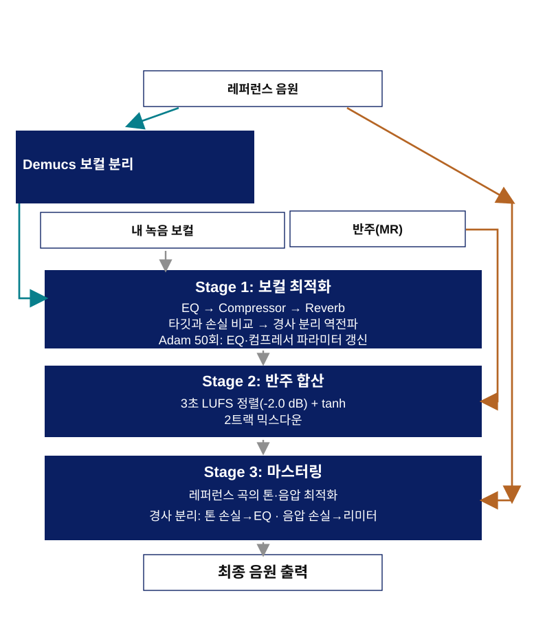

<!-- _class: lead -->

# 레퍼런스 추종 End-to-End 믹싱 & 마스터링 시스템

이현중

<!-- speaker notes: 발표를 맡은 이현중입니다 -->

---

# 1. 믹싱과 마스터링은 무엇인가?

### 믹싱 · 마스터링은 **요리**와 같다.

<!-- 믹싱 마스터링은 요리와 같습니다. 요리란 다양한 재료를 섞어 하나의 완성된 음식을 만드는것입니다. 믹싱 마스터링도 마찬가지로 작곡 작사 후 레코딩한 재료~~ 
믹싱은 재료를 손질하고 어떤 비율로 넣을지 결정하는 과정이고 
마스터링은 완성된 음식에 마지막으로 맛을 보고 간을 조금 더 치고 하는 최종 마무리 과정입니다 음악 특성상 볼륨을 올리는게 가장 중요한 과제라고 할수있습니다.-->

---

# 2. DDSP에서 본 핵심 아이디어

**디지털 신호 처리(DSP)를 미분 가능한 연산으로 구성하면, 출력과 목표의 차이를 이용해 파라미터를 자동 조정할 수 있다.**

- 사람 손으로 찾던 EQ, 컴프레서 값을 자동으로 찾기 

<!-- speaker notes: 저는 믹싱을작업 외주를 받고 작업한 경험이 여럿 있고 믹싱 마스터링 작업을 좋아합니다. 캡스톤을 준비하며 디디에스피를 알게되었고 이렇게하듯이 자동으로 믹싱을 해주면 어떨까 하는 마음에서 연구가 시작되었습니다.  -->

---

# EQ와 Compressor란?

## EQ · 주파수별로 크기를 조정

주파수별 소리의 크기를 각각 조절해 보컬의 **톤과 음색 균형**을 다듬습니다.

## Compressor · 음량의 들쭉날쭉함을 조절

큰 소리는 눌러 피크를 제어하고, 작은 소리와의 음량 차이(다이나믹스)를 줄입니다.

<!-- speaker notes: EQ는 주파수에 따라 소리의 크기를 조절해 음색을 바꾸는 도구입니다. 예를 들어 저음을 줄이거나 존재감을 주는 중고역을 조절할 수 있습니다. 컴프레서는 큰 소리를 기준으로 눌러서 소리 크기의 차이를 줄이는 도구입니다. 우리 보컬 처리 단계에서는 레퍼런스와의 톤 차이를 EQ가, Crest Factor 차이를 컴프레서가 줄이도록 최적화합니다. 마스터링 단계에서 피크를 제한하는 리미터는 이 보컬 컴프레서와 구분되는 별도 처리입니다. -->

---

# 3. 시스템은 이렇게 동작합니다

<!-- speaker notes: 이 그림은 전체 처리 흐름입니다. 레퍼런스 보컬과 입력 보컬을 비교해야 할 때는 Demucs 보컬 분리 기능(torchaudio HDEMUCS_HIGH_MUSDB_PLUS)으로 레퍼런스에서 보컬을 분리합니다. 두 보컬의 톤과 다이내믹스 차이를 바탕으로 EQ와 컴프레서 파라미터를 최적화합니다. 입력 보컬과 반주(MR)는 별도 입력으로 받습니다. 보컬을 최적화한 뒤 반주가 있으면 3초 구간의 LUFS를 기준으로 정렬하고 두 트랙을 합산합니다. 마스터링 단계에서는 반주 합산 결과와 레퍼런스 음원의 톤·음압을 비교해 EQ와 리미터를 최적화합니다. 마지막으로 처리된 음원을 출력합니다. -->

---

# 4. 시연

<!-- speaker notes: 여기서 실제 프로그램을 실행합니다. 사용할 파일명과 옵션을 발표 전에 채웁니다. 처리에 시간이 걸릴 수 있으니 앱이 이미 실행되어 있는지, 입력 파일이 준비되어 있는지 확인합니다. -->

---

# 5. 결과를 함께 들어보겠습니다

<!-- speaker notes: 같은 구간을 재생해 비교합니다. 재생 음량이 다른 경우 큰 쪽이 더 좋게 들리는 편향이 있으니 주의하고, 가능하면 공정한 음량으로 맞춰 듣습니다. 곡 전체 인상과 함께 치찰음, 저역, 피크, 잔향도 들어봅니다. -->

---

# 6. 결과 분석: 수치와 귀를 함께 봅니다

| 분석 항목 | 원본 | 처리 결과 | 레퍼런스 |
|---|---:|---:|---:|
| Tone error | [실제 값] | [실제 값] | — |
| Crest Factor | [실제 값] dB | [실제 값] dB | [실제 값] dB |
| Peak / LUFS | [실제 값] | [실제 값] | [실제 값] |

- 톤 그래프에서 200 Hz–10 kHz 대역의 균형 변화 확인
- CF 차이와 게인 리덕션을 보고 압축 변화 해석
- 청취에서 느낀 변화와 수치가 같은 방향인지 비교

<!-- speaker notes: 이 표는 시연한 파일의 실제 결과로 채웁니다. 프로그램 화면이나 결과 JSON에서 같은 사례의 지표를 가져옵니다. 숫자가 줄었다고 무조건 더 좋은 소리라고 결론 내리지 않고, 청취 결과와 같이 해석합니다. -->

<!-- speaker notes: 합성 신호 테스트는 시스템 계산 경로가 실행되는지 보는 테스트이며 실제 음원 성능 평가와는 다릅니다. 실제 음원마다 녹음과 편곡이 달라 결과도 달라질 수 있습니다. 현재 확인한 범위와 추가로 확인해야 할 부분을 구분해 설명합니다. -->

---

# 마무리

**레퍼런스와의 차이를 측정하고, DSP 파라미터를 자동으로 조정하는 보컬 믹싱 도구**

- 미분 가능한 DSP를 보컬 EQ·컴프레서에 적용
- 톤과 다이내믹스 목표를 나눠 최적화
- 결과 그래프와 A/B 청취로 변화 확인

### 질문 감사합니다

<!-- speaker notes: DDSP에서 얻은 아이디어를 실제 보컬 처리 흐름으로 구현하고, 레퍼런스와 비교해 EQ와 컴프레서 설정을 자동 조정했습니다. 들어주셔서 감사합니다. -->
